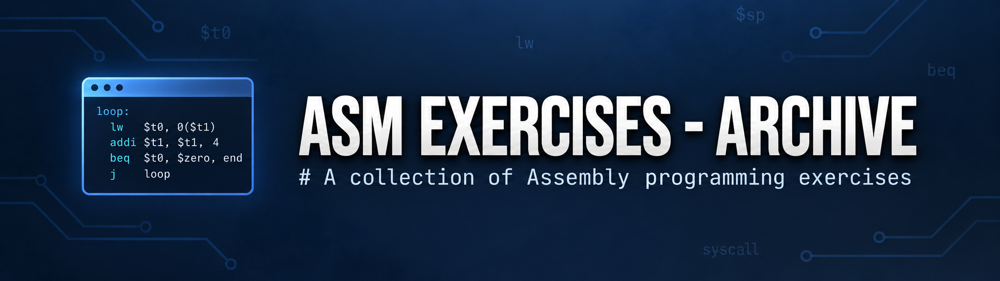

<h1 align="center">
   ASM Exercises - Archive
</h1>

<p align="center">
   A chronological archive of Assembly programming exercises from my learning journey.
</p>

<p align="center">
   
   
   
</p>

</br>


## 📖 About

**ASM Exercises - Archive** is a personal collection of Assembly programming exercises that I am completing as part of my university coursework.
This repository represents an effort to organize these exercises in one place.

By making them public, I hope they can serve as a resource for others who are learning or practicing Assembly programming.
Whether you are a student, a self-learner, or someone interested in low-level programming, this archive aims to provide useful exercises covering different programming concepts.

## 📂 Repository Structure

Exercises are mainly organized by year and date:

```text
ASM-Exercises/
├── 2026/
├── 2027/
└── Extras/
```

> [!TIP]
> Older exercises generally cover more basic topics, while later ones tend to become progressively more complex.

Where available, the original task, prompt, or problem statement is included as a comment in the corresponding `.s` file. The `Extras` directory contains additional exercises that do not belong to the main chronological structure.

## 🗃️ Archive Policy

> [!IMPORTANT]
> This repository is a historical archive, not a collection of reference solutions.
> The exercises are intentionally preserved close to how I originally wrote them, so some may contain mistakes, incomplete implementations, inefficient approaches, or code that I would write differently today.

This is intentional: the goal is to preserve the original learning process rather than turn every exercise into an ideal solution.

## 💻 Using the Exercises

You are welcome to browse the repository, study the exercises, or use them as inspiration for your own practice.

To clone the archive:

```bash
git clone https://github.com/T-i-a-7/ASM-Exercises.git
```

The exercises currently use MIPS Assembly. An assembler or simulator has not yet been configured, so instructions for assembling and running the programs will be added in the future.

If you want to modify, correct, complete, or experiment with the exercises, creating your own fork is recommended.

> [!NOTE]
> The code in this repository should not be treated as authoritative or production-ready Assembly code. Some exercises reflect early stages of my learning and may contain errors or incomplete solutions.

## 🤝 Contributions and Feedback

This repository is primarily a personal archive, so changes that rewrite, correct, complete, or replace historical exercise solutions are generally not intended to be merged into the archive.

Feedback and contributions related to the repository itself — such as documentation, organization, broken references, or metadata — are still welcome.

Alternative or improved solutions are best explored in a fork, where the original archived versions can remain unchanged.

## 📄 License

This repository is licensed under the [MIT License](LICENSE).